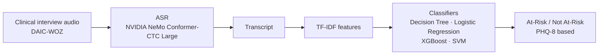

# Assessing Mental Health from Audio using Automatic Speech Recognition

**BSc thesis, Budapest University of Technology and Economics (BME), December 2025**
Author: Dilnaz Zholmaganbet · Advisor: Dr. Péter Mihajlik

Can a fully automated pipeline (speech → ASR transcript → classifier) screen clinical interviews for depression risk, and how much do ASR errors hurt? This repository contains the thesis document and the acoustic deep-learning experiments carried out during the project.

📄 **Thesis:** [`docs/BSc_Thesis_Dilnaz_Zholmaganbet.pdf`](docs/BSc_Thesis_Dilnaz_Zholmaganbet.pdf)

## Thesis pipeline and results



- **Data:** DAIC-WOZ clinical interviews with PHQ-8 scores (class imbalance handled during training).
- **ASR:** NVIDIA NeMo Conformer-CTC Large, evaluated against the manual transcripts.
- **Classifiers:** Decision Tree, Logistic Regression, XGBoost and SVM on TF-IDF features, trained on manual transcripts and tested on both manual and ASR transcripts.
- **Result:** the best model (SVM) on **ASR transcripts** reached **71.4% accuracy** with **83.3% sensitivity** for "At-Risk" participants. General-purpose ASR causes only a small loss in screening performance, so automated audio-based screening is a realistic option for telehealth.

## Acoustic experiments: `wav2vec2-experiments/`
Before settling on the transcript-based approach, I tested whether depression levels can be detected **directly from the audio signal**, using a public Kaggle speech dataset organized into *Normal*, *Depression/Stage1* and *Depression/Stage2* folders (400 clips).

| Script | Purpose |
|---|---|
| `test_environment.py` | Checks PyTorch, Transformers, librosa and CUDA |
| `explore_kaggle_dataset.py`, `audio_info.py` | Explore the dataset structure and audio properties |
| `create_dataset.py` | Builds `dataset_labels.csv` from the folder structure |
| `resampling_dataset.py` | Resamples all audio to 16 kHz (required by wav2vec2), keeping the folder structure |
| `baseline_model.py` | Baseline: MFCC and spectral features + Random Forest |
| `fine_tune_depression_1.py` | First fine-tuning of `facebook/wav2vec2-base` for 3 classes |
| `enhanced_fine_tuning.py` | Improved training: class weights, balanced resampling, early stopping |
| `enhanced_features_log.py` | Stable training configuration with TensorBoard logging |
| `binary_classification.py` | Binary task: Normal vs. Depression (Stage1 + Stage2), with AUC |
| `feature_analysis.py`, `visual_representation.py`, `conversion_npy.py` | ANOVA significance tests on extracted features, heatmaps, CSV export |

### Run
```bash
cd wav2vec2-experiments
pip install -r requirements.txt
python test_environment.py
# put the audio in data/Original_Dataset/{Normal,Depression/Stage1,Depression/Stage2}
python create_dataset.py
python resampling_dataset.py          # -> data/Corrected_Dataset (16 kHz)
python baseline_model.py
python binary_classification.py       # trains and saves ./binary_depression_model
tensorboard --logdir tensorboard_logs
```

## Data and ethics
- **No audio, transcripts or trained models are included.** DAIC-WOZ is available only under a research license agreement and may not be redistributed. The Kaggle audio has to be downloaded from its source.
- The models are a research prototype for **preliminary screening**, not a diagnostic tool.

## Tech
Python · PyTorch · Hugging Face Transformers (wav2vec2) · NVIDIA NeMo ASR · scikit-learn · XGBoost · librosa · TensorBoard
